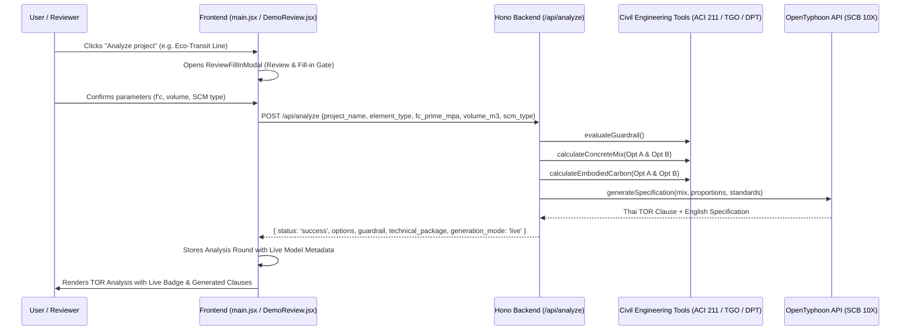

# Live OpenTyphoon Model Integration for Document & Specification Analysis

**Date:** 2026-10-11  
**Status:** Approved by User  
**Author:** Pair Programming Agent & User  

---

## 1. Objective
Allow GreenSpec users, guests, and presentation reviewers to perform real end-to-end document and requirement analysis using the live **OpenTyphoon** model (`typhoon-v2.5-30b-a3b-instruct`). When clicking "Analyze project" in any project (including `Eco-Transit Line`), the system will:
1. Extract requirements via `/api/extract-requirements`.
2. Allow engineering parameter verification in `ReviewFillInModal`.
3. Invoke `/api/analyze` to execute deterministic civil engineering calculation tools (`calculateConcreteMix`, `calculateEmbodiedCarbon`, `evaluateGuardrail`).
4. Generate authentic Thai and English technical specifications, Option A and Option B wording, and rationale via OpenTyphoon LLM.
5. Present the live-generated round in the TOR Analysis workspace with clear `⚡ Live OpenTyphoon Model (SCB 10X)` provenance badges and an inspectable specification drawer for judge verification.

---

## 2. Architecture & Data Flow

---

## 3. Detailed Component Changes

### 3.1 Backend: `server/server.mjs`
- **Authentication Middleware on `/api/analyze`:**
  - Remove restrictive `createReader` session requirement from `/api/analyze` so guest tokens and demo reviewer sessions can execute live analyses.
  - Maintain truthful error reporting: return 503 (`AI_NOT_CONFIGURED`) only if `TYPHOON_API_KEY` is not set.
- **Enhanced Output Payload:**
  - In `/api/analyze`, include:
    - `generation_mode: 'live'`
    - `model: 'typhoon-v2.5-30b-a3b-instruct'`
    - `technical_package.spec_clause_th` (Thai TOR Clause)
    - `technical_package.spec_clause_en` (English CSI 3-Part Clause)
    - Option A and Option B proportions, carbon reductions, and cost notes.

### 3.2 Frontend: `frontend/src/main.jsx`
- **`handleConfirmRequirements(items)`:**
  - Display loading indicator: `"กำลังเรียก OpenTyphoon AI เพื่อวิเคราะห์ข้อกำหนดและคำนวณคาร์บอน..."`
  - Send `POST /api/analyze` with:
    - `project_name: project.name`
    - `element_type: items[0].element_type`
    - `fc_prime_mpa: items[0].fc_prime_mpa`
    - `volume_m3: items[0].volume_m3`
    - `scm_type: items[0].scm_type || 'fly_ash'`
  - On receiving response:
    - Format live recommendation with Option A and Option B using the model's actual technical clauses and calculations.
    - Attach metadata: `{ generation_mode: 'live', model: 'typhoon-v2.5-30b-a3b-instruct', live_spec_th: data.technical_package.spec_clause_th, live_spec_en: data.technical_package.spec_clause_en }`.
    - Save round via `writeDemo` / demo round storage for the user and project.
    - Navigate to `#workspace?project=${project.id}&tab=review&run=${newRound.id}&stage=hotspots`.

### 3.3 Frontend: `frontend/src/DemoReview.jsx`
- Display **`⚡ Live OpenTyphoon Model (SCB 10X)`** badge at the top of the recommendation card when `generation_mode === 'live'`.
- Add an inspectable accordion/drawer:
  - **"📄 ข้อกำหนดที่ร่างโดย OpenTyphoon AI (Live Model Output)"**
  - Displays the raw Thai clause and English CSI MasterFormat clause generated by the model.

---

## 4. Error Handling & Fallback
- If the OpenTyphoon API returns a network error or rate limit, display a clear, honest error message toast with a retry option.
- The pre-existing pitch demo projects (`Bangkok Green Tower`) remain untouched in local storage so the user always has a backup benchmark.

---

## 5. Verification Plan
- **Automated Tests:**
  - Verify `/api/analyze` works for guest sessions without 401 error.
  - Run all existing test suites (`npm test`, `npm run test:api`, `npm run test:backend`).
- **Interactive Verification:**
  - Run `POST /api/analyze` via curl with valid OpenTyphoon credentials to ensure genuine text is returned.
  - Verify `Eco-Transit Line` analysis flow in the browser.
