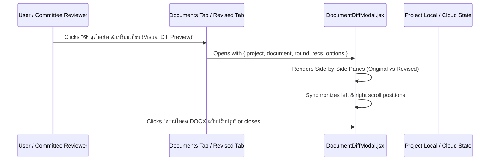

# Document Diff Viewer with BBox Highlights Specification

**Date:** 2026-10-12  
**Status:** Approved by User  
**Author:** Pair Programming Agent & User  

---

## 1. Objective
Provide an interactive, visual **Split-Screen Document Diff Viewer** allowing engineers, owners, and evaluation committees to inspect and verify document modifications before downloading finalized files. The viewer displays:
- Side-by-side comparison between the original specification (ต้นฉบับเดิม) and the AI-revised green specification (ฉบับปรับปรุงสีเขียว).
- Visual Bounding Boxes (BBox highlights) surrounding modified clauses with color-coded badges and carbon reduction impact metrics.
- Synchronized scrolling and 1-click BBox jump navigation.
- Pre-download actions to export revised DOCX, comparison report JSON, or finalize the review.

---

## 2. User Experience & Architecture

---

## 3. Component Design

### 3.1 `frontend/src/DocumentDiffModal.jsx`
- **Props:**
  - `isOpen: boolean`
  - `onClose: () => void`
  - `project: object`
  - `document: object`
  - `round: object` (active analysis round containing approved recommendations)
  - `canEdit: boolean`
- **Features & 5-Page A4 Physical Structure:**
  1. **Top Bar Header & Sub-toolbar:**
     - Title: `เปรียบเทียบเอกสารข้อกำหนด (Specification Diff Preview)`
     - View mode toggle: `จอคู่เคียงข้าง (Side-by-Side)`, `ฉบับร่างเดิม (Baseline)`, `ฉบับปรับปรุง (Approved)`.
     - Synchronized scroll toggle and quick Page Jump buttons `[1] [2] [3] [4] [5]`.
     - Clause BBox chips: `[จุดที่ 1: คอนกรีตฐานราก]`, `[จุดที่ 2: เหล็กเสริมข้ออ้อย]`, `[จุดที่ 3: บล็อกผนังมวลเบา]`.
  2. **Page 1 (หมวดที่ 1 ข้อกำหนดทั่วไป & มาตรา 2.1 ปูนซีเมนต์ไฮดรอลิก):**
     - Centered vector Thai Garuda Crest (`ThaiGarudaEmblem`).
     - Identification metadata: Document No. (`GS-TOR-2569/P1`), Date, Project Name, Status.
     - Section 1.1 Scope, 1.2 Engineering References (มยผ. 1101-64, มอก. 2594, มอก. 2135, ACI 207).
     - Clause 2.1 Low-Carbon Cement (OPC baseline vs TIS 2594 + 35% Fly Ash).
  3. **Page 2 (หมวดที่ 2 ข้อกำหนดวัสดุ & หมวดที่ 3 การควบคุมงาน):**
     - Clause 2.2 Structural Rebar (EAF scrap ≥90% with ISO 14025 EPD).
     - Clause 2.3 Interior AAC masonry blocks (TIS 1505-2541 G4).
     - Section 3.1 Mass concrete thermal control (T_max ≤ 70°C, ΔT ≤ 20°C, Thermocouple 7 days).
     - Section 3.2 Moist curing for at least 14 days.
  4. **Page 3 (หมวดที่ 4 การตรวจรับพัสดุ & หมวดที่ 5 การลงนามคณะกรรมการ):**
     - Submittals & testing requirements (ISO/IEC 17025 compressive tests, Mill certificates).
     - Formal TOR Procurement Committee 4-person signature grid.
  5. **Page 4: เอกสารแนบท้าย ๑ (Engineering Calculation Annex):**
     - **Table ๑: Mix Proportions (1 m³)**: ACI 211.1 Absolute Volume conservation (227.5 kg Hydraulic cement, 122.5 kg Fly Ash, W/B 0.38, 2.8 L PCE superplasticizer, 1,000 L volume).
     - **Table ๒: Embodied Carbon Verification**: TGO factors (234.8 kgCO₂e/m³ vs 348.0 kgCO₂e/m³ baseline, -32.5% reduction, 465.8 tCO₂e saved).
     - **Table ๓: Strength Development & Formwork Stripping Safety (ACI 209 / มยผ. 1101-64)**:
       - Progression at 3, 7, 14, 28, 56, 90 days.
       - Formwork stripping threshold: ≥70% f'c (24.5 MPa) achieved at day 14 (safe soffit removal).
       - Contractual acceptance: ≥100% f'c achieved at day 56 (36.4 MPa ≥ 35.0 MPa).
     - **Table ๔: ACI 207 Hourly Mass Concrete Thermal Simulation**:
       - 0h to 168h (7 days) progression.
       - Baseline: Peak Core = 74.0°C (DEF FAIL), Peak ΔT = 28.5°C (Cracking FAIL).
       - Mitigated Green Mix: Peak Core = 61.2°C (DEF SAFE < 70°C), Peak ΔT = 14.8°C (Cracking SAFE ≤ 20°C).
     - **Professional Engineering (PE) Certification Stamp**: Signatures for Concrete Mix Design PE and TGO Carbon Verification Specialist.
  6. **Page 5: เอกสารแนบท้าย ๒ (Cost & Budget Impact Annex - แบบ บก.๐๖):**
     - **Comptroller General's Department Official Budget Form**: Allocated Budget 26,000,000.00 THB, Calculated Median Price 24,921,920.00 THB.
     - **Comparative BOQ Pricing Table**: Item-by-item breakdown across 3 work packages. Proves 800,855.00 THB net savings (3.11%) alongside 718.3 tCO₂e carbon reduction.
     - **Zero Green Premium Justification Card**: Financial justification proving that compliant green materials reduce binder and installation costs.
     - **Procurement Cost Verification Signatures**: Cost Estimator / Quantity Surveyor (สย. 51042) and Head of Procuring Entity / Project Director.
  7. **Export Engines:**
     - OpenXML Word (`generateFormalDocxBlob` in `formal-document-generator.mjs`): 100% 5-page layout, tables, and signatures matching the viewer.
     - Native Print / PDF Window (`getFormalHtmlContent` in `formal-document-generator.mjs`): Full 5-page print container.
     - Multi-Sheet OpenXML Excel (`generateFormalExcelBlob` / `exportFormalExcel` in `formal-excel-generator.mjs`):
       - Sheet 1: แบบ บก.๐๖ (Official Comptroller General's Dept form).
       - Sheet 2: BOQ_Comparative (Dynamic OpenXML formulas `=D5*F5`, `=G5-I5`, `=SUM(G5:G7)`, `=SUM(J5:J7)`).
       - Sheet 3: Engineering_Calculations (Mix design, carbon math, strength and thermal data).
     - UTF-8 BOM CSV Export (`exportBoqCsv`): Clean importable spreadsheet for e-GP and ERP systems.

---

## 4. Verification Evidence
- **Automated Tests:**
  - `npm test`: 15/15 tests pass (including shared civil tools and Excel generator).
  - `npm run test:api`: 18/18 tests pass.
  - `npm run test:backend`: 5/5 tests pass.
  - Total: 38/38 tests passing across the repository with zero regressions.
- **Client Build:**
  - `npm run build:client` succeeds with 0 errors in 1.34s.
6f4ea` mint, `#f8fdf9` card backgrounds).
- Clean paper textures with realistic margins, paragraph indentations, and floating BBox badges.

### 3.3 Integration in `frontend/src/main.jsx`
- Add entry point button **`👁️ ดูตัวอย่าง & เปรียบเทียบ (Visual Diff Preview)`** to document cards in `Documents` component.
- Add entry point button to the header of `DemoReview.jsx` (TOR Analysis & Revised Document).

---

## 4. Verification Plan
- **Unit & Integration:**
  - Verify modal opens and renders with valid project round data.
  - Verify synchronized scrolling behaves correctly without jitter.
  - Verify BBox jump chips highlight target clauses.
  - Verify tests continue to pass (`npm test`, `npm run test:api`, `npm run test:backend`).
- **Build & Quality:**
  - `npm run build` succeeds with zero errors.
