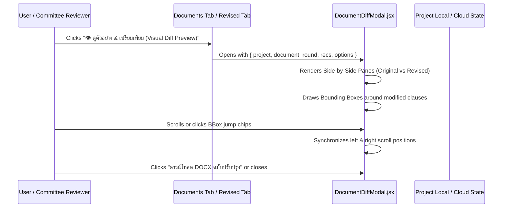

# Document Diff Viewer with BBox Highlights Specification

**Date:** 2026-10-12  
**Status:** Approved by User  
**Author:** Pair Programming Agent & User  

---

## 1. Objective
Provide an interactive, visual **Split-Screen Document Diff Viewer** allowing engineers, owners, and evaluation committees to inspect and verify document modifications before downloading finalized files. The viewer displays:
- Side-by-side comparison between the original specification (ต้นฉบับเดิม) and the AI-revised green specification (ฉบับปรับปรุงสีเขียว).
- Visual Bounding Boxes (BBox highlights) surrounding modified clauses with color-coded badges and carbon reduction impact metrics.
- Synchronized scrolling and 1-click BBox jump navigation.
- Pre-download actions to export revised DOCX, comparison report JSON, or finalize the review.

---

## 2. User Experience & Architecture

---

## 3. Component Design

### 3.1 `frontend/src/DocumentDiffModal.jsx`
- **Props:**
  - `isOpen: boolean`
  - `onClose: () => void`
  - `project: object`
  - `document: object`
  - `round: object` (active analysis round containing approved recommendations)
  - `canEdit: boolean`
  - `onDownloadDocx?: () => void`
- **Features:**
  1. **Top Bar Header:**
     - Title: `เปรียบเทียบเอกสารข้อกำหนด (Specification Diff Preview)`
     - Document title and tag.
     - Metrics badges: e.g. `🟢 3 จุดที่ปรับปรุง`, `📉 -32% คาร์บอนแฝง`, `มอก. 2135 / ACI 207`.
     - Toggle view mode: `จอคู่เคียงข้าง (Side-by-Side)` vs `มุมมองเดี่ยว (Single Pane)`.
  2. **Left Pane (Original Specification):**
     - Page sheet styling (white paper aesthetic with subtle drop shadow).
     - Full document text structure with standard Section 03 30 00 layout.
     - **Amber/Red BBox highlights** around original high-carbon requirements:
       - e.g. `Type I Ordinary Portland Cement 100% (High Carbon Intensity ~350 kgCO2e/m³)`
       - e.g. `Standard 28-day cylinder compressive strength (No SCM allowance)`
  3. **Right Pane (Green Revised Specification):**
     - Matching page sheet styling with green header accent.
     - **Emerald Green BBox highlights** around revised low-carbon requirements:
       - e.g. `ปูนซีเมนต์ไฮดรอลิกผสมเถ้าลอย 35% (มอก. 2135-2545) ลดคาร์บอน 32%`
       - e.g. `ขยายอายุทดสอบกำลังอัดเป็น 56 วัน เพื่อรองรับเถ้าลอย`
       - e.g. `ควบคุมอุณหภูมิ Mass Concrete ΔT ≤ 20°C (ACI 207.2R) และบ่มชื้นอย่างน้อย 14 วัน`
     - Status badges: `Approved`, `Option B Selected`.
  4. **Interactive BBox Controls:**
     - Top navigation chips: `[จุดที่ 1: คอนกรีตฐานราก]`, `[จุดที่ 2: เหล็กเสริมข้ออ้อย]`, `[จุดที่ 3: บล็อกผนังมวลเบา]`
     - Clicking a chip smooth-scrolls both panes to the corresponding clause and briefly pulses the BBox.
     - Synchronized scroll event handler with anti-looping flags.
  5. **Footer Bar:**
     - Action buttons:
       - `📥 ดาวน์โหลด DOCX ฉบับปรับปรุง`
       - `📄 ดาวน์โหลดรายงานเปรียบเทียบ (JSON)`
       - `✕ ปิดหน้าต่าง (Close)`

### 3.2 Styling: `frontend/src/diff-viewer.css`
- Responsive design supporting desktop split-screen (50/50) and mobile tabbed view.
- Premium styling following GreenSpec palette (`#005c46` forest, `#10b981` emerald, `#e6f4ea` mint, `#f8fdf9` card backgrounds).
- Clean paper textures with realistic margins, paragraph indentations, and floating BBox badges.

### 3.3 Integration in `frontend/src/main.jsx`
- Add entry point button **`👁️ ดูตัวอย่าง & เปรียบเทียบ (Visual Diff Preview)`** to document cards in `Documents` component.
- Add entry point button to the header of `DemoReview.jsx` (TOR Analysis & Revised Document).

---

## 4. Verification Plan
- **Unit & Integration:**
  - Verify modal opens and renders with valid project round data.
  - Verify synchronized scrolling behaves correctly without jitter.
  - Verify BBox jump chips highlight target clauses.
  - Verify tests continue to pass (`npm test`, `npm run test:api`, `npm run test:backend`).
- **Build & Quality:**
  - `npm run build` succeeds with zero errors.
